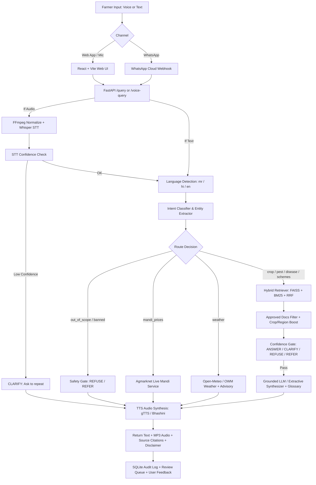

# System Architecture — KrishiMitra (कृषीमित्र)

## 1. End-to-End Pipeline Flowchart

## 2. Module Responsibilities

| Layer | Modules | Core Responsibility |
|---|---|---|
| **Channel & UI** | `frontend-web/`, `backend/api/whatsapp.py` | Mobile-first React UI with mic recording; Meta WhatsApp webhook & audio media dispatch |
| **Speech & Language** | `speech_to_text.py`, `text_to_speech.py`, `language_detection.py`, `translation.py` | Whisper ASR + imageio-ffmpeg normalization, gTTS/Bhashini audio, Devanagari/langdetect, SQLite Glossary |
| **Intent & Safety** | `intent_classifier.py`, `safety_service.py` | 8 agricultural intents, 7 entity types, 4-way gate (`ANSWER`, `CLARIFY`, `REFUSE`, `REFER`) |
| **Trusted RAG** | `document_processor.py`, `embeddings.py`, `vector_store.py`, `retriever.py` | PyMuPDF + SHA-256 hash dedup, MiniLM-L12 embeddings, FAISS IndexFlatIP, BM25 + RRF fusion |
| **Live Data** | `weather_service.py`, `mandi_service.py` | Open-Meteo (no key) & OpenWeatherMap live weather + Agmarknet APMC pricing with TTL caching |
| **Governance & Eval** | `db.py`, `routes.py`, `scripts/benchmark.py` | Document approval workflow, expert review queue, feedback loop, Recall@5 & safety metrics |
